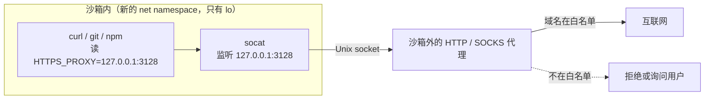

沙箱里的命令没有网卡，所有流量只能交给沙箱外的代理，由代理按域名白名单决定放不放行。

## 为什么不用防火墙

防火墙按 IP 过滤，而 `github.com`、`registry.npmjs.org` 背后是 CDN，IP 会变、还和别的网站共用。HTTP 代理能看到目标**域名**（HTTPS 的 `CONNECT github.com:443`），按域名放行更准确，也不需要 root 去改防火墙。

## Linux 上的数据路径

1. 新的 [net namespace](../../linux/namespaces.md) 里只有 `lo`，命令无法直连任何外部地址。
2. 沙箱给命令设置 `HTTP_PROXY`、`HTTPS_PROXY`、`ALL_PROXY` 等环境变量，指向沙箱内的一个本地端口。
3. 沙箱内的 `socat` 把这个端口转发到一个 Unix socket；这个 socket 文件挂载进了沙箱，另一端连着沙箱外的代理。
4. 代理检查目标域名，在白名单内就转发。
5. [seccomp](../../linux/seccomp.md) 禁止命令自己新建 Unix socket，防止它绕过代理去连宿主上的其他 socket。

macOS 上不需要 socat：[Seatbelt](../../macos/seatbelt.md) 规则直接只允许连本机代理端口。

## 后果

- 不认代理环境变量的程序（自己开裸 TCP 的工具）连不出去。
- Git over SSH 不是 HTTP，需要改用 HTTPS remote，或用 `GIT_SSH_COMMAND` 让 ssh 通过代理的 `CONNECT` 建立连接。
- 代理凭据通常放在环境变量里，属于敏感信息，不要打印到日志。

## 相关

- [Claude Code 的沙箱](claude-code.md)
- [常见的坑](pitfalls.md)
