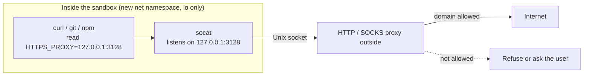

Commands in the sandbox have no network interface; all traffic goes to a proxy outside the sandbox, which allows or refuses it by domain.

## Why not a firewall

Firewalls filter by IP, but `github.com` and `registry.npmjs.org` sit behind CDNs whose IPs change and are shared with other sites. An HTTP proxy sees the **domain** (HTTPS sends `CONNECT github.com:443`), so it can allow by name, and it needs no root to configure.

## The data path on Linux

1. The new [net namespace](../../linux/namespaces.md) has only `lo`; nothing outside is reachable directly.
2. The sandbox sets `HTTP_PROXY`, `HTTPS_PROXY`, `ALL_PROXY` and similar variables to a local port inside the sandbox.
3. `socat` inside forwards that port to a Unix socket mounted into the sandbox, whose other end is the proxy outside.
4. The proxy checks the destination domain and forwards it if allowed.
5. [seccomp](../../linux/seccomp.md) stops commands from creating Unix sockets of their own, so they can't bypass the proxy to reach other host sockets.

On macOS there's no socat: the [Seatbelt](../../macos/seatbelt.md) profile only allows connecting to the local proxy port.

## Consequences

- Programs that ignore proxy variables (tools opening raw TCP) can't get out.
- Git over SSH isn't HTTP: switch to an HTTPS remote, or set `GIT_SSH_COMMAND` so ssh tunnels through the proxy's `CONNECT`.
- Proxy credentials usually live in environment variables; they're secrets, so keep them out of logs.

## Related

- [Claude Code's sandbox](claude-code.md)
- [Common pitfalls](pitfalls.md)
