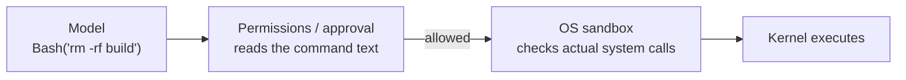

A tool call goes through two checks between the model and execution: application-level **permissions** read what the command says; the kernel-level **OS sandbox** watches what the process actually does.

## Two gates

| | Permissions | OS sandbox |
| --- | --- | --- |
| Where | Inside the agent program | The operating-system kernel |
| Decides by | Command text, tool names, rule lists, hooks | The system calls the process makes |
| Weakness | Commands can be rephrased to slip past; anything unrecognised means asking a human, often | Only covers the processes it wraps; too-broad settings make it hollow |
| Claude Code | permissions (allow/deny rules, hooks) | sandbox ([bubblewrap](../../linux/bubblewrap.md) / [Seatbelt](../../macos/seatbelt.md)) |
| Codex | `approval_policy` | `sandbox_mode` |

## Why both

With permissions alone, every unfamiliar command needs a human, and people soon click "allow" without reading.

With a sandbox, a command can at most change the working directory and reach allowlisted hosts, so commands inside can run without asking; only boundary crossings need approval. Both products follow the same idea: **confine first, then approve only what crosses the boundary**.

## What the sandbox doesn't cover

Only shell commands and their children are sandboxed. In Claude Code, built-in tools such as Read, Edit and WebFetch, MCP servers and hooks run outside the OS sandbox and rely on permission rules alone.

## Related

- [Claude Code's sandbox](claude-code.md)
- [Codex's sandbox](codex.md)
